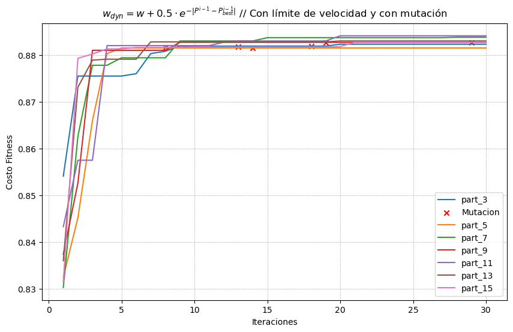
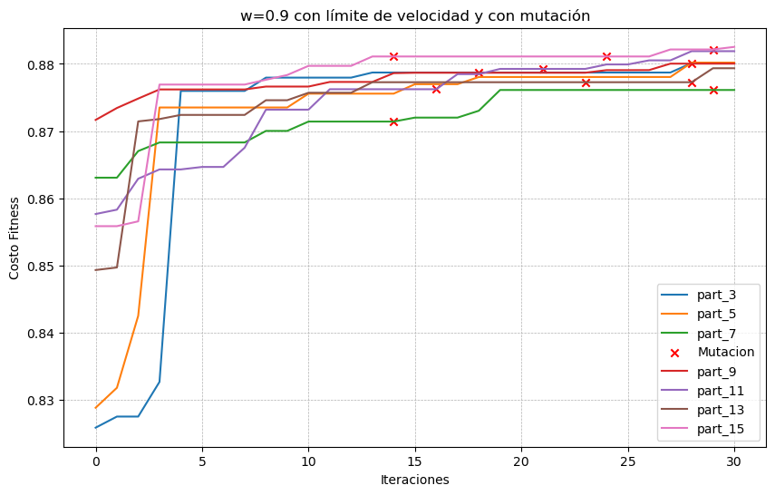
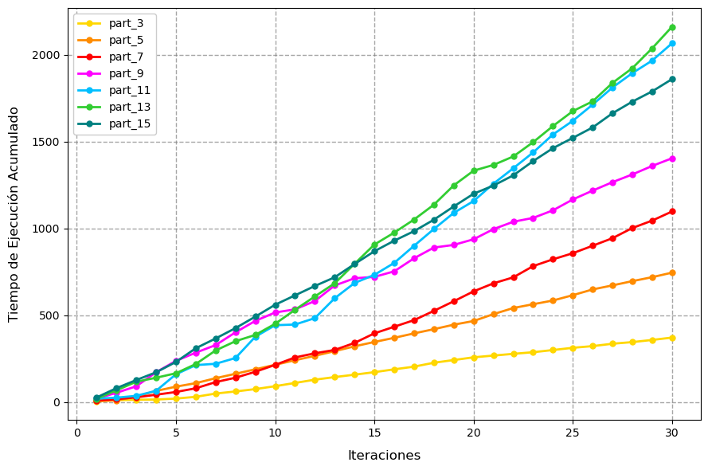
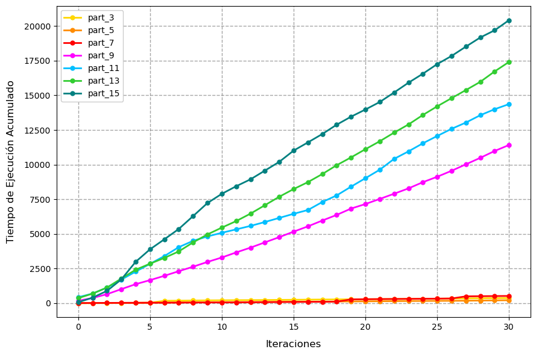

# PSO Hyperparameter Optimization Study

**Bachelor's Thesis** — Álvaro Pleguezuelos Escobar

## Resumen / Abstract

**EN:** Machine Learning is a key tool for solving diverse problems. However, its accuracy depends on properly tuning hyperparameters, whose optimization can be computationally expensive, especially in high-dimensional spaces. In this context, heuristic techniques emerge as a viable alternative to exact methods such as Grid Search. This work studies the metaheuristic algorithm **Particle Swarm Optimization** both theoretically and experimentally, applying it to the ranking classification of ATP circuit tennis players. Results show that PSO is an efficient option, although proper parameter tuning is necessary for its correct performance.

**Keywords:** Machine Learning, PSO, Particle Swarm Optimization, Hyperparameter Optimization, Heuristics, Tennis, ATP.

---

## Repository Structure

```
.
├── data/
│   └── 2010_2023.csv          # ATP player statistics dataset (2010–2023)
├── notebooks/
│   ├── 01_analysis.ipynb      # Main notebook: preprocessing, Grid Search, PSO
│   ├── 02_plot_fitness.ipynb  # Fitness evolution plots
│   ├── 03_plot_time.ipynb     # Execution time plots
│   └── 04_data_transformer.ipynb  # CSV result transformer utility
├── results/
│   ├── ejecuciones_finales.csv    # Aggregated final experiment results
│   └── <experiment_configs>/      # Per-configuration CSVs and plots
├── figures/
│   └── thesis_figures/        # Figures used in the thesis document
├── docs/
│   └── thesis.pdf             # Full thesis document (Spanish)
├── requirements.txt
└── LICENSE
```

---

## Requirements

Python 3.9+ is recommended.

```bash
pip install -r requirements.txt
```

Dependencies: `pandas`, `numpy`, `scikit-learn`, `matplotlib`, `seaborn`, `imbalanced-learn`, `jupyter`.

---

## How to Run

1. Clone the repository and install dependencies:

   ```bash
   git clone https://github.com/alplegue/TFG-Alvaro-Pleguezuelos.git
   cd TFG-Alvaro-Pleguezuelos
   pip install -r requirements.txt
   ```
2. Start Jupyter:

   ```bash
   jupyter notebook
   ```
3. Open the notebooks in order:

   - `notebooks/01_analysis.ipynb` — main experiment (data loading, preprocessing, Grid Search baseline, PSO)
   - `notebooks/02_plot_fitness.ipynb` — visualize fitness evolution across experiments
   - `notebooks/03_plot_time.ipynb` — visualize execution time across experiments

> **Note:** Running the PSO cells in `01_analysis.ipynb` is computationally expensive (each run can take several hours). Pre-computed results are available in `results/`.

---

## Experiment Results

The `results/` directory contains CSV outputs and plots from all PSO configurations tested. Each configuration was run with swarm sizes of 3, 5, 7, 9, 11, 13 and 15 particles over 30 iterations. Metrics below are aggregated from [`results/ejecuciones_finales.csv`](results/ejecuciones_finales.csv); fitness is the cross-validated accuracy of the Random Forest classifier.

**Key findings**

- **Adaptive inertia + mutation + speed limit** is the most robust configuration: highest mean fitness (0.8829) and convergence within ~5 iterations.
- With **fixed w = 0.9**, mutations multiply the runtime (8–9k s on average, up to ~20k s for a single run) for only marginal accuracy gains.
- **Best single run:** 0.8841 accuracy (adaptive w, speed limit, 13 particles).
- Runtime grows roughly linearly with swarm size, while fitness plateaus around 11–13 particles.

### Highlights

<table>
  <tr>
    <th>Adaptive w + mutation + speed limit (best)</th>
    <th>Fixed w = 0.9 + mutation + speed limit (slowest)</th>
  </tr>
  <tr>
    <td></td>
    <td></td>
  </tr>
  <tr>
    <td></td>
    <td></td>
  </tr>
</table>

With adaptive inertia, every swarm reaches ~0.88 accuracy within a few iterations and the whole run stays under ~2,200 s. With fixed inertia, particles climb slowly over the 30 iterations and the largest swarms take up to ~20,000 s.

<details>
<summary><b>All 8 configurations: fitness and runtime plots</b></summary>

<br>

| Config                        | Fitness evolution | Cumulative runtime |
| ----------------------------- | :---------------: | :----------------: |
| `w9_nomut_nospeedlimit`     |                  |                    |
| `w9_nomut_speedlimit`       |                  |                    |
| `w9_mut_nospeedlimit`       |                  |                    |
| `w9_mut_speedlimit`         |                  |                    |
| `w_evol_nomut_nospeedlimit` |                  |                    |
| `w_evol_nomut_speedlimit`   |                  |                    |
| `w_evol_mut_nospeedlimit`   |                  |                    |
| `w_evol_mut_speedlimit`     |                  |                    |

</details>

> **Note:** Plot labels are in Spanish: *Costo Fitness* = fitness (accuracy), *Iteraciones* = iterations, *Tiempo de Ejecución Acumulado* = cumulative runtime (s), *part_N* = swarm of N particles, *Mutación* = mutation event. The full statistical analysis (ANCOVA on swarm size, mutation, speed limit and inertia type) is in [`docs/thesis.pdf`](docs/thesis.pdf).

---

## License

This project is licensed under the GNU General Public License v3.0. See [LICENSE](LICENSE) for details.
